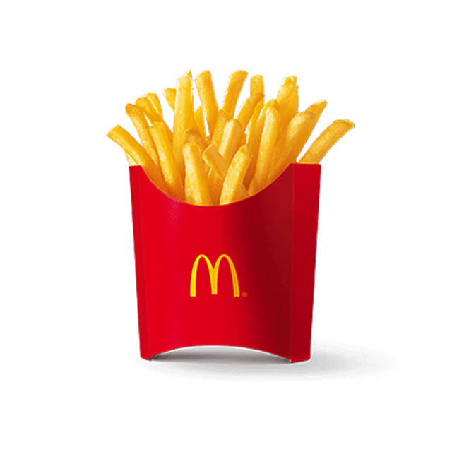
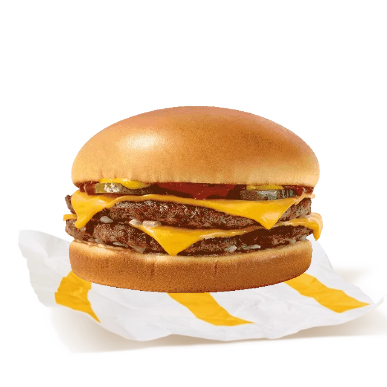
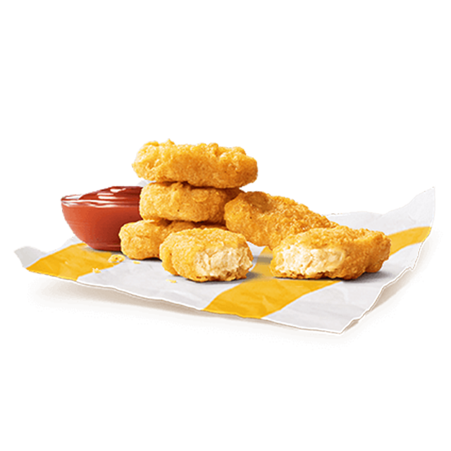
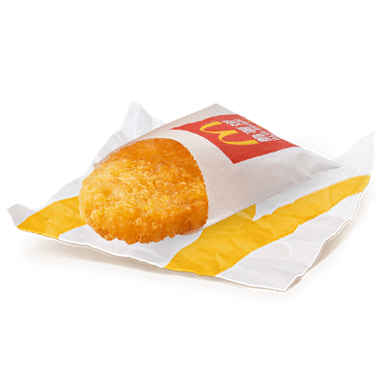

<div align="center">


# 麦有谱

### 同样的麦当劳，不同的吃法。

薯条换个蘸法，汉堡加一层惊喜。<br />从你手里的几样，发现菜单之外的小快乐。

<a href="https://suikv000.github.io/mai-you-pu/"></a>

无需安装 · 无需填写 Token · 手机也能打开

[挑个吃法](#今天想怎么搭)　 /　[安装 Skill](#把麦有谱装进对话里)　 /　[MCP 接入](MCP_INTEGRATION.md)

</div>

<a href="https://suikv000.github.io/mai-you-pu/"></a>

<div align="center">

**13 款配方**　 ·　 **汉堡 / 甜品 / 早餐**　 ·　 **一张卡分享吃法**

</div>

## 今天想怎么搭？

<table>
<tr>
<td align="center" width="33%">
<p><sub>01 / DIP</sub></p>
<h3>蘸一蘸，咸甜刚刚好</h3>
 
<p><strong>薯条 × 圆筒</strong></p>
<p>现蘸现吃，给熟悉的薯条<br />添一口冰凉奶香。</p>
<p><sub>官方历史吃法</sub></p>
</td>
<td align="center" width="33%">
<p><sub>02 / STACK</sub></p>
<h3>合个体，多一层酥脆</h3>
 
<p><strong>双吉 × 麦乐鸡</strong></p>
<p>两块鸡块夹进双吉，<br />剩下的照常吃。</p>
<p><sub>官方灵感 · 简化适配</sub></p>
</td>
<td align="center" width="33%">
<p><sub>03 / SANDWICH</sub></p>
<h3>夹一夹，试试冰火搭档</h3>
 
<p><strong>薯饼 × 麦旋风</strong></p>
<p>两片薯饼、一层冰淇淋，<br />尝试冷热交错的一口。</p>
<p><sub>媒体灵感 · 口味适配</sub></p>
</td>
</tr>
</table>

<sub>官方单品图为组合示意，非成品实拍。配方保留来源与改编说明，尚未经过本项目口味实测。</sub>

## 把餐盘交给麦有谱

**① 选你有的** → **② 看怎么搭** → **③ 留下这一口**

选餐品、调数量，就能看到已有食材能做什么、还差哪一样。勾选 **“只用这些，不想再买”**，只看材料够用的组合。喜欢的吃法可以收藏、复制文案，或下载分享卡。

<p align="center"><a href="https://suikv000.github.io/mai-you-pu/#playground"><strong>我的餐盘，还能怎么吃？ →</strong></a></p>

## 有些快乐，值得等它回来

季节单品离开后，旧吃法留在麦谱里。Skill 通过官方 MCP 查询新品与回归线索，再对照原食材：有依据才说回来，没确认就继续等。

**12 款普通组合 + 1 款历史限定**，把今天能搭的和以后想吃的都留下。

<sub>网页活动区展示 2026-10-18 的读取快照；实时活动查询需要在助手中连接官方 MCP，活动信息不等于门店库存。</sub>

## 把麦有谱装进对话里

> **你：** 我有双吉和两块麦乐鸡，不想再买。<br />
> **麦有谱：** 试试「鸡块双吉堡」。已有食材就能做，没有烧烤酱就标为无酱适配版。

适合想换种吃法、利用已有餐品或关注季节单品的消费者。网页可以直接体验，Skill 则让你在对话里找配方、查新品、做分享文案。


<details>
<summary><strong>安装 Skill · 展开步骤</strong></summary>

把仓库的 `skills/mai-you-pu` 文件夹复制到支持该格式的助手技能目录。Codex 示例（首次安装；已有同名技能请先比较再更新）：

```sh
mkdir -p ~/.codex/skills
cp -R skills/mai-you-pu ~/.codex/skills/
```

重新加载客户端后使用：

> 使用 $mai-you-pu：我有双吉和两块麦乐鸡，不想再买东西。

> 使用 $mai-you-pu：查一下最近的官方活动，看看哪些老吃法可能复活；没有依据就标待核实。

实时查询需另外连接官方 MCP，见 [接入说明](MCP_INTEGRATION.md) 和 [配置示例](mcp-config.example.json)。客户端需支持远程 MCP、Skill 和环境变量配置。离线演示无需 Token。

</details>

<details>
<summary><strong>开发与数据 · 本地运行、功能范围</strong></summary>

[本地开发说明](docs/DEVELOPMENT.md) · [MCP 接入说明](MCP_INTEGRATION.md) · [配置示例](mcp-config.example.json)

配方库在 `skills/mai-you-pu/references/recipes.json`，前端副本为 `dist/recipes.json`，维护时同步更新。来源、改编说明、日期和证据标签保留在数据内。

匹配在本地浏览器完成。收藏不跨设备，餐盘刷新后不保留。无 AI 后端、公共社区、自动发帖或点餐；分享按钮只生成素材。配方未经项目方口味实测，当前供应和价格以门店为准。活动快照时间是 2026-10-18，不自动更新。

</details>

<details>
<summary><strong>素材与开源许可</strong></summary>

原创代码及技能文字采用 [MIT](LICENSE)。官方单品图片、产品名称及商标归各自权利人，**不在本项目 MIT 授权范围内**；图片来源在 [清单](dist/assets/sources.json) 和 [图片说明](dist/assets/credits.html)。AI 辅助制作的薯条蘸圆筒 logo 与酱料示意见 [AI 素材说明](dist/assets/generated-sources.json)，不是官方标识或商品照片。

</details>

<details>
<summary><strong>参赛信息</strong></summary>

参加麦当劳程序员节创意开发大赛；[参赛声明](CONTEST_DECLARATION.md) 使用官方原文。使用 Codex 开发，不申报 WorkBuddy 专项。报名结果以官方 Issue 回执为准。

</details>

<br />

<div align="center">


**一口，搭出新花样。**

[在线体验](https://suikv000.github.io/mai-you-pu/) · [配方库](dist/recipes.json) · [反馈想法](https://github.com/suikv000/mai-you-pu/issues)

<sub>独立创意项目 · 非麦当劳官方产品 · 原创代码 MIT 开源</sub>

</div>
