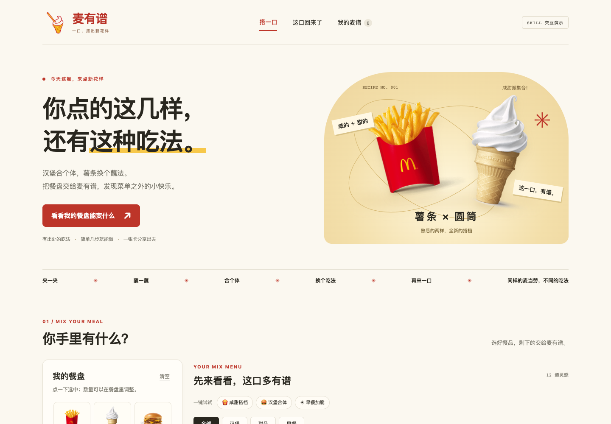

<div align="center">
  
  <h1>麦有谱</h1>
  <p><strong>同样的麦当劳，不同的吃法。</strong></p>
  <p>薯条蘸圆筒，汉堡合个体。<br />把手里的几样，搭成菜单之外的小快乐。</p>
  <p>
    
    
    
    
  </p>
  <p><a href="https://suikv000.github.io/mai-you-pu/">🍟 在线体验</a> · <a href="#运行演示">本地运行</a> · <a href="#安装-skill">安装 Skill</a> · <a href="MCP_INTEGRATION.md">MCP 接入</a> · <a href="dist/recipes.json">翻翻配方库</a></p>
</div>



## 今天这顿，换个吃法

你手里有薯条和圆筒，可以直接来一口咸甜；有双吉和麦乐鸡，就试试夹进汉堡。**麦有谱先看你已经有什么，再告诉你怎么搭。** 缺材料会写明，也支持“只用这些，不想再买”。

| 🍟 蘸一蘸 | 🍔 合个体 | 🍦 夹一夹 |
| :--- | :--- | :--- |
| 薯条 × 圆筒 | 双吉 × 麦乐鸡 | 薯饼 × 麦旋风 |
| 咸甜薯条，现蘸现吃 | 鸡块双吉，添一层酥脆 | 冰火夹心，尝试冷热组合 |
| 官方历史吃法 | 官方灵感，简化适配 | 媒体灵感，口味适配 |

这些是有来源的吃法或注明差异的改编，尚未经过本项目口味实测。

## 从一张餐盘，到一张麦谱

| 选你手里的 | 看怎么组合 | 留住这一口 |
| :--- | :--- | :--- |
| 选择餐品与数量，按汉堡、甜品、早餐筛选 | 查看已有食材、还差什么、操作步骤和来源 | 本机收藏、复制文案，或下载 PNG 分享卡 |

**13 款配方 · 12 款普通组合 · 1 款历史限定**。官方原例、媒体灵感、食材改编与脑洞分别标注；不会把“准备试试”写成“亲测好吃”。

## 老吃法，也有再见的一天

季节单品离开后，配方留在麦谱里。Skill 可通过麦当劳官方 MCP 查询新品和回归消息，再对照原食材寻找线索。未确认的继续显示“等回归”，相似新品不冒充原版。

> **网页负责看得见，Skill 负责聊得来。**
> “我有双吉和两块麦乐鸡，不想再买。”
> “最近哪些新品，能让以前的吃法复活？”

适合想换种吃法、利用已有餐品或关注季节单品的消费者。独立创意项目，非麦当劳官方产品。

## 运行演示

**[打开在线演示 →](https://suikv000.github.io/mai-you-pu/)** · 无需安装或填写 Token，即可选餐品、匹配吃法和下载分享卡。活动区展示带日期的历史快照。

需要 Python 3，无第三方依赖。在仓库目录运行：

```sh
python3 -m http.server 8768 --bind 127.0.0.1 --directory dist
```

打开 http://127.0.0.1:8768/ 。选择薯条与圆筒，点击“这几样怎么吃”；或选择双吉和两块麦乐鸡，勾选“只用这些”。详情可看来源、步骤和下载分享卡。

## 安装 Skill

把仓库的 `skills/mai-you-pu` 文件夹复制到支持该格式的助手技能目录。Codex 示例（首次安装；已有同名技能请先比较再更新）：

```sh
mkdir -p ~/.codex/skills
cp -R skills/mai-you-pu ~/.codex/skills/
```

重新加载客户端后使用：

> 使用 $mai-you-pu：我有双吉和两块麦乐鸡，不想再买东西。

> 使用 $mai-you-pu：查一下最近的官方活动，看看哪些老吃法可能复活；没有依据就标待核实。

实时查询需另外连接官方 MCP，见 [接入说明](MCP_INTEGRATION.md) 和 [配置示例](mcp-config.example.json)。客户端需支持远程 MCP、Skill 和环境变量配置。离线演示无需 Token。

## 数据与限制

配方库在 `skills/mai-you-pu/references/recipes.json`，前端副本为 `dist/recipes.json`，维护时同步更新。来源、改编说明、日期和证据标签保留在数据内。

匹配在本地浏览器完成。收藏不跨设备，餐盘刷新后不保留。无 AI 后端、公共社区、自动发帖或点餐；分享按钮只生成素材。配方未经项目方口味实测，当前供应和价格以门店为准。活动快照时间是 2026-10-18，不自动更新。

## 素材与许可

原创代码及技能文字采用 [MIT](LICENSE)。官方单品图片、产品名称及商标归各自权利人，**不在本项目 MIT 授权范围内**；图片来源在 [清单](dist/assets/sources.json) 和 [图片说明](dist/assets/credits.html)。AI 辅助制作的薯条蘸圆筒 logo 与酱料示意见 [AI 素材说明](dist/assets/generated-sources.json)，不是官方标识或商品照片。

参考 [麦麦热量管家](https://github.com/WilderNoTrack/mcd-calorie-butler) 的 Skill + 示例页面组织方式，本项目代码与文字独立实现。

## 参赛

参加麦当劳程序员节创意开发大赛；[参赛声明](CONTEST_DECLARATION.md) 使用官方原文。使用 Codex 开发，不申报 WorkBuddy 专项。报名结果以官方 Issue 回执为准。
